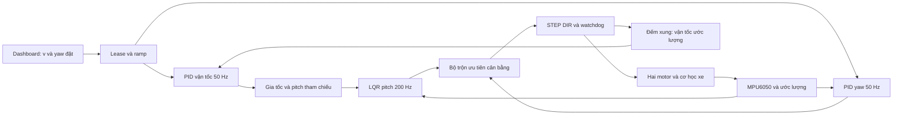
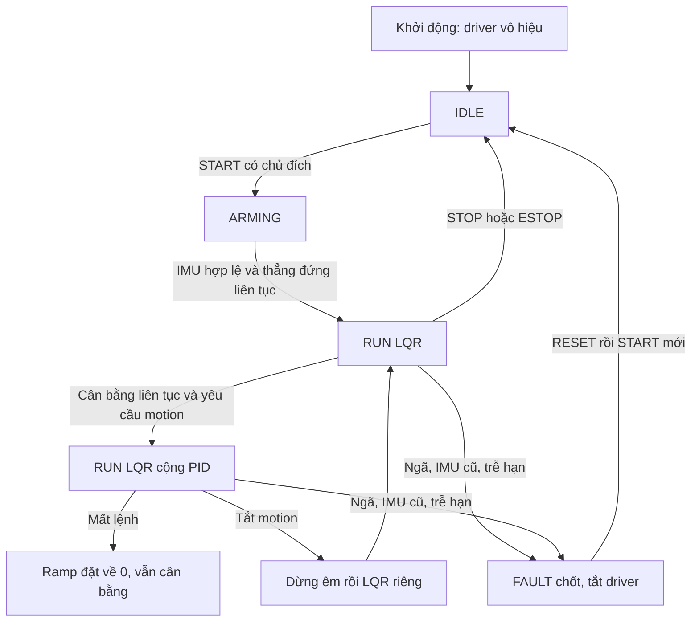

# Sơ đồ điều khiển và luồng firmware

Đường đếm xung là phản hồi theo giả định bám bước, không phải encoder.

STOP là dừng driver; không đồng nghĩa lệnh vận tốc0. ESTOP/fault cụ thể phải
đọc state machine firmware; kết nối lại web không tự kích hoạt xe.
