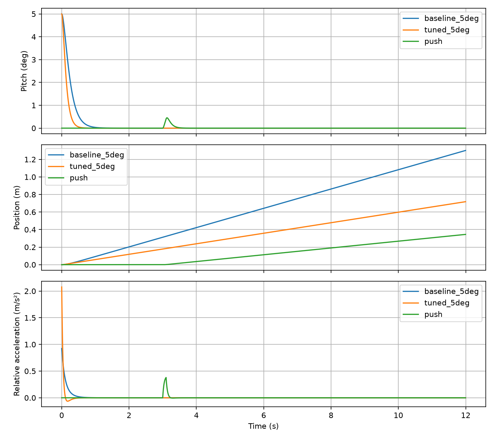
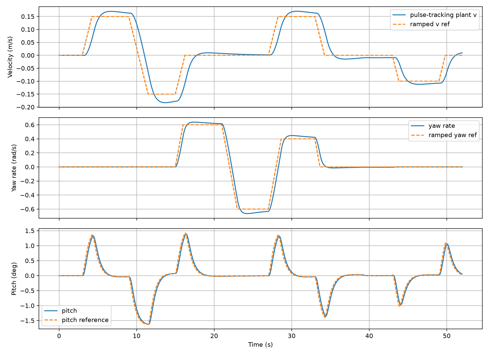

# Kết quả mô phỏng Python

Dữ liệu phi tuyến có giới hạn STEP; không phải kết quả thử xe. Cấu hình `nema17-relative-v1`.

| Ca | Pitch đỉnh (°) | Xác lập góc (s) | x cuối (m) | u đỉnh (m/s²) | Bão hòa (s) | Ngã |
|---|---:|---:|---:|---:|---:|---|
|baseline_5deg|5.0000|0.52|1.3020|0.9219|0.0000|False|
|tuned_5deg|5.0000|0.34|0.7180|2.0764|0.0000|False|
|tuned_10deg|10.0000|0.41500000000000004|1.4792|3.0000|0.0200|False|
|tuned_15deg|15.0000|0.47000000000000003|2.4554|3.0000|0.0500|False|
|push|0.4517|3.11|0.3450|0.3796|0.0000|False|
|motion|1.6244|50.765|0.4370|0.1475|0.0000|False|

Xác lập góc: vào và giữ |θ|≤0.5°, |ω|≤0.05rad/s đến cuối mô phỏng. Với ca chuyển động nhiều đoạn, cột này là thời điểm cuối cùng hết quá độ, không phải thời gian đáp ứng của từng đoạn. x cuối ca chuyển động là dịch chuyển có chủ đích cộng sai số, không gọi toàn bộ là trôi.

Bộ tinh chỉnh là lựa chọn đánh đổi tốc độ góc, độ trôi và công điều khiển, không tuyên bố tối ưu toàn cục. `qr_sweep.csv` chứa12 ứng viên. LQR riêng giữ góc nhưng còn vận tốc dư; bật PID đặt0 để giảm vận tốc trong giả định bám bước.

| Cuối đoạn (s) | Sai số v (m/s) | Sai số yaw (rad/s) | Pitch (°) |
|---|---:|---:|---:|
|8.9|0.01332|0.00000|-0.0391|
|14.9|-0.02822|0.00000|0.0696|
|20.9|0.00727|0.01516|-0.0201|
|26.9|0.00153|-0.03296|-0.0048|
|32.9|0.01363|0.02247|-0.0401|
|38.9|-0.01049|-0.00579|0.0302|
|48.9|-0.00771|0.00012|0.0230|

## Kiểm tra tiêu chí

- pitch_settle_under_2s: PASS
- motion_pitch_under_8deg: PASS
- motion_plateau_velocity_under_003: PASS
- motion_plateau_yaw_under_008: PASS

## Giới hạn

Quét một tham số mỗi lần và một lưới trễ/gain bám; không chứng minh ổn định với mọi tổ hợp bất định. Đầu ra torque chỉ là yêu cầu mô hình, chưa có đường cong pull-out motor để kết luận bám được. Mô hình yaw không có trượt ngang/ma sát; IMU lý tưởng trong các ca chính, chưa xác minh bộ lọc trên xe.

