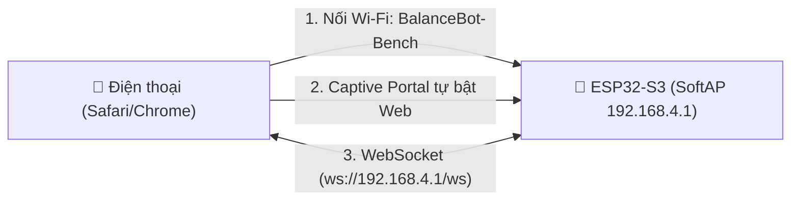

# Hướng Dẫn: Chạy Web Điều Khiển Độc Lập Trên Điện Thoại (Không Cần Máy Tính)

> Tài liệu kỹ thuật giải quyết bài toán: **Loại bỏ hoàn toàn máy tính trung gian**, cho phép điện thoại kết nối trực tiếp với ESP32-S3 để điều khiển xe cân bằng.

---

## 1. Tại Sao Kiến Trúc Cũ Cần Máy Tính?

1. **Giao thức mạng của ESP32-S3 hiện tại**: 
   Firmware ESP32-S3 hiện đang dùng `WiFiServer server(8080)`. Đây là một **Raw TCP Socket** (socket nhị phân thô).
2. **Rào cản trình duyệt trên điện thoại (Mobile Browser Sandbox)**:
   Trình duyệt web di động (Safari trên iPhone, Chrome trên Android) tuân thủ tiêu chuẩn an toàn web W3C, **bị cấm mở kết nối Raw TCP socket**. Trình duyệt chỉ được phép mở kết nối qua **HTTP/HTTPS** hoặc **WebSocket (`ws://`, `wss://`)**.
3. **Vai trò trước đây của máy tính**:
   Máy tính chạy `web_server.js` (Node.js) đóng vai trò là **Cầu nối (Protocol Bridge)**:
   $$\text{Điện thoại} \xrightarrow[\text{WebSocket}]{\text{HTTP/WS}} \text{Node.js Server (PC)} \xrightarrow[\text{Raw TCP}]{\text{Cổng 8080}} \text{ESP32-S3}$$

---

## Nhúng Web Server + WebSocket Trực Tiếp Lên ESP32-S3 

Đây là giải pháp chuẩn công nghiệp IoT, biến xe cân bằng thành một thiết bị độc lập 100%:



### Ưu điểm vượt trội:
- **Không cần máy tính, không cần router Wi-Fi ngoài**: Mang xe ra sân, lớp học, hội trường đều điều khiển được.
- **Tính năng Captive Portal**: Khi điện thoại kết nối Wi-Fi của xe, màn hình điều khiển sẽ **tự động nhảy ra** giống như trang đăng nhập Wi-Fi khách sạn/quán cafe, người dùng không cần nhớ hay gõ bất kỳ địa chỉ IP nào.
- **Độ trễ thấp hơn**: Bỏ qua máy tính trung gian, lệnh điều khiển gửi trực tiếp tới ESP32-S3 qua WebSocket nội bộ với độ trễ chỉ 5–15 ms.

### Các bước triển khai trên ESP32-S3:

#### Bước 1: Thêm thư viện vào Arduino IDE / PlatformIO
- `ESPAsyncWebServer` và `AsyncTCP` (hoặc `WebSocketsServer` của Markus Sattler).
- `DNSServer` (tích hợp sẵn trong ESP32 Core để làm Captive Portal).

#### Bước 2: Nhúng mã nguồn Web vào Flash ESP32-S3
Toàn bộ mã giao diện HTML, CSS, JS sau khi tối ưu và nén Gzip chỉ chiếm khoảng **25 KB**, được đặt trong thư mục `data/` của LittleFS hoặc nén thành mảng `const uint8_t web_index_html_gz[] PROGMEM`.

#### Bước 3: Mã nguồn C++ tích hợp vào Firmware (`EspWebBridge.h`)

```cpp
#include <WiFi.h>
#include <ESPAsyncWebServer.h>
#include <AsyncTCP.h>
#include <DNSServer.h>

static AsyncWebServer server(80);
static AsyncWebSocket ws("/ws");
static DNSServer dnsServer;

// Gửi Telemetry chu kỳ 40ms qua WebSocket
void broadcastTelemetry(const char* telemetryLine) {
    if (ws.count() > 0) {
        ws.textAll(telemetryLine);
    }
}

// Xử lý lệnh nhận được từ điện thoại
void onWsMessage(void *arg, uint8_t *data, size_t len) {
    AwsFrameInfo *info = (AwsFrameInfo*)arg;
    if (info->final && info->index == 0 && info->len == len && info->opcode == WS_TEXT) {
        data[len] = 0;
        char* line = (char*)data;
        // Chuyển line tới hàm acceptLine(line, 2) sẵn có trong Runtime.cpp
        // Ví dụ: START, STOP, RESET, CMD,...
    }
}

void onWsEvent(AsyncWebSocket *server, AsyncWebSocketClient *client, 
               AwsEventType type, void *arg, uint8_t *data, size_t len) {
    if (type == WS_EVT_CONNECT) {
        client->text("ACK:CONNECTED");
    } else if (type == WS_EVT_DATA) {
        onWsMessage(arg, data, len);
    }
}

void setupStandaloneWeb() {
    // 1. Khởi tạo SoftAP
    WiFi.mode(WIFI_AP);
    WiFi.softAP("BalanceBot-Bench", "BalanceBot13");

    // 2. Bật Captive Portal (Chuyển hướng mọi tên miền về 192.168.4.1)
    dnsServer.start(53, "*", WiFi.softAPIP());

    // 3. Đăng ký WebSocket
    ws.onEvent(onWsEvent);
    server.addHandler(&ws);

    // 4. Phục vụ trang Web (Gzip)
    server.on("/", HTTP_GET, [](AsyncWebServerRequest *request){
        AsyncWebServerResponse *response = request->beginResponse_P(200, "text/html", web_html_gz, web_html_gz_len);
        response->addHeader("Content-Encoding", "gzip");
        request->send(response);
    });

    // Bắt các request Captive Portal của Android/iOS (generate_204, hotspot-detect)
    server.onNotFound([](AsyncWebServerRequest *request){
        request->redirect("http://192.168.4.1/");
    });

    server.begin();
}

void loopStandaloneWeb() {
    dnsServer.processNextRequest();
    ws.cleanupClients();
}
```